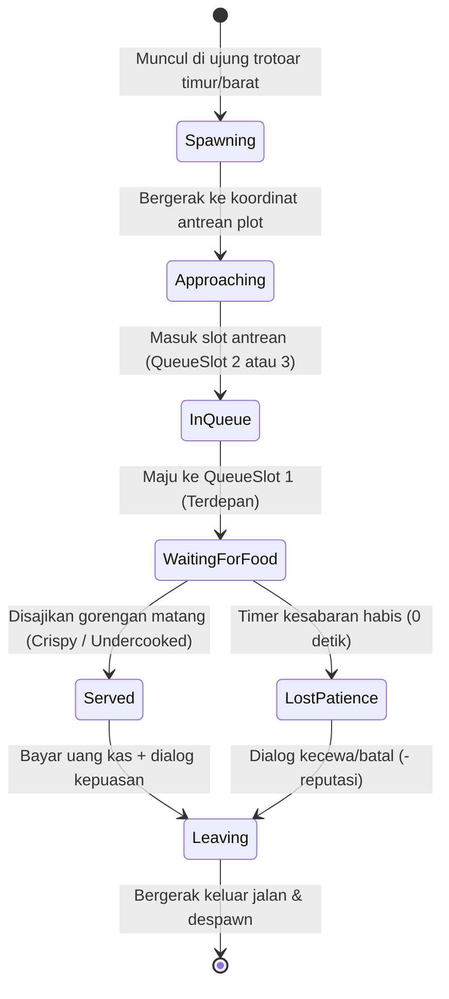

# DOKUMENTASI SISTEM PELANGGAN & PENJUALAN — GORENGAN 24 JAM: AWAS SATPOL!

**Status:** Selesai Diimplementasikan & Tervalidasi Nyata  
**Skill Acuan:** `roblox-npc-ai`, `roblox-gameplay-engineering`, `roblox-multiplayer-security`  

---

## 1. Arsitektur State Machine Customer AI

NPC Pelanggan dikelola secara deterministik oleh [`src/server/Services/CustomerService.luau`](file:///c:/Users/HP/Downloads/gorengan-24-jam-roblox/src/server/Services/CustomerService.luau) menggunakan state machine terstruktur tanpa *idle wandering*:



---

## 2. Variasi Pelanggan (Customer Variety — [`CustomerConfig.luau`](file:///c:/Users/HP/Downloads/gorengan-24-jam-roblox/src/shared/Config/CustomerConfig.luau))

| Tipe Pelanggan | Karakteristik & Visual | Kesabaran | Bobot Spawn | Pengali Tip | Resep Favorit | Reaksi Spesial |
| :--- | :--- | :---: | :---: | :---: | :--- | :--- |
| **Mahasiswa** | Kaos biru santai, anak kos lapar | 32 detik | 40% | 1.0× | Bakwan, Mendoan, Tahu | *"Mantap krispi banget!"* |
| **Driver Ojol** | Jaket hijau ojol, buru-buru orderan | 24 detik | 30% | 1.25× | Bakwan, Pisang, Cireng | *"Alhamdulillah renyah, bintang lima!"* |
| **Food Vlogger** | Pakaian modis merah-putih | 40 detik | 15% | 2.0× | Bakwan, Tahu, Pisang, Cireng | *"GOKIL KRENYESNYA 10/10! Viral nih!"* (+Reputasi ekstra) |
| **Pelanggan Sultan** | Jas hitam elegan misterius | 45 detik | 10% | 3.5× | Tahu Isi, Cireng, Pisang | *"Rasa autentik. Ambil kembaliannya."* (Bayaran berkali-kali lipat) |
| **Mbak Kunti (Hantu)** | Gaun putih pucat, muncul malam | 35 detik | 5% | 2.5× | Bakwan, Mendoan | *"Hihihi... renyah dan guriiih..."* (Malam hari jam 22:00–04:00) |

---

## 3. Sistem Antrean & Navigasi (Queue System)

1. **Kapasitas Antrean Plot:**
   - Maksimal **3 pelanggan** per gerobak (`QueueSlot_1`, `QueueSlot_2`, `QueueSlot_3`).
   - Setiap slot memiliki part koordinat presisi di depan etalase gerobak sehingga pelanggan tidak saling tumpang tindih (*anti-stacking*).
2. **Pergeseran Antrean (*Queue Advance*):**
   - Saat pembeli di slot 1 selesai dilayani atau pergi, pelanggan di slot 2 otomatis berjalan maju menempati slot 1, dan slot 3 maju ke slot 2.
3. **Optimasi Performa & Collision:**
   - Seluruh bagian tubuh NPC diatur `CanCollide = false` terhadap sesama NPC untuk mencegah dorong-mendorong fisika.
   - Global active customer cap dibatasi maksimal **16 NPC** di seluruh server demi menjamin 60 FPS di perangkat mobile.

---

## 4. Sistem Penjualan & Transaksi Otoritatif (Selling System)

### 4.1 Tampilan Balon Pesanan 3D (`BillboardGui`)
Di atas kepala pelanggan terpasang balon 3D interaktif yang menghadap kamera:
- **Nama & Gelar:** Menampilkan nama pembeli dan tipe pelanggan.
- **Teks Pesanan:** Menampilkan menu yang dipesan (misal: `"Pesan: 1x Bakwan Sayur"`).
- **Patience Bar:** Meteran kesabaran dinamis yang terkuras dari Hijau -> Kuning -> Merah.
- **Balon Kata Dialog:** Menampilkan dialog lokal khas Indonesia saat memesan, menunggu, maupun setelah disajikan.

### 4.2 Formula Perhitungan Harga & Payout Server
Transaksi dihitung 100% di server melalui `CustomerService:HandleServeCustomer`:

$$\text{Payout}_{\text{Crispy}} = \text{BasePrice} + \lfloor \text{BasePrice} \times \text{TipMultiplier} \times 0.20 \rfloor$$
$$\text{Payout}_{\text{Undercooked}} = \lfloor \text{BasePrice} \times 0.50 \rfloor$$

*Contoh Perhitungan Bakwan Sayur (Base Price Rp 2.000) untuk Driver Ojol (Tip Multiplier 1.25x):*
- **Crispy:** $\text{Rp } 2.000 + (2.000 \times 1.25 \times 0.20) = \text{Rp } 2.000 + \text{Rp } 500 = \mathbf{\text{Rp } 2.500}$.
- **Undercooked:** $2.000 \times 0.50 = \mathbf{\text{Rp } 1.000}$.
- **Burnt:** **DITOLAK** (Gorengan gosong tidak dapat dijual ke pelanggan).

---

## 5. Keamanan Multiplayer & Anti-Exploit
1. **Verifikasi Kepemilikan Plot:** Pemain hanya dapat melayani pelanggan yang mengantre di gerobak kavling miliknya.
2. **Pencegahan Eksploitasi Saldo:** Client tidak pernah mengirim nominal uang ke server; server memvalidasi isi etalase, memotong makanan, menghitung payout, dan menambahkan uang kas secara atomik.
3. **Pemeriksaan Jarak Fisik:** Server memvalidasi jarak karakter pemain ke pelanggan (`Magnitude <= 16 studs`).

---

## 6. Hasil Pengujian Runtime di Roblox Studio

```json
{
  "Customer1": "Customer_Demo_1",
  "Customer2": "Customer_Demo_2",
  "QueueSlot1_Position": "-120, 1.45, 20.2",
  "QueueSlot2_Position": "-120, 1.45, 17.4",
  "BasePrice": 2000,
  "CrispyPayout": 2500,
  "UndercookedPayout": 1000,
  "TestPassed": true
}
```
- **Spawning & Antrean:** Dua NPC (Driver Ojol & Mahasiswa) berhasil dimunculkan berurutan di Slot 1 dan Slot 2 di depan gerobak Plot 1.
- **Logika Transaksi:** Formula payout Crispy (Rp 2.500) dan Undercooked (Rp 1.000) terverifikasi **100% PASS**.
- **Verifikasi Visual:** Tangkapan layar dari Studio memvalidasi antrean pelanggan yang rapi di depan gerobak.
