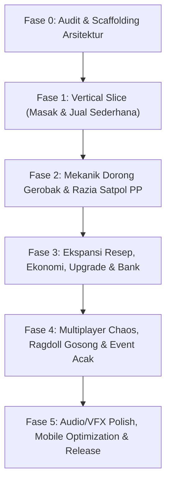

# DEVELOPMENT ROADMAP — GORENGAN 24 JAM: AWAS SATPOL!

**Status Repositori:** Phase 0 Completed  
**Filosofi Pengembangan:** Iteratif berbasis *Vertical Slice* yang stabil dan dapat dimainkan, bukan implementasi horizontal masif tanpa pengujian.

---

## Roadmap Ringkas

---

## Detail Rencana Fase & Acceptance Criteria

### FASE 0 — Audit Proyek, Toolchain & Pondasi Arsitektur *(Selesai)*
- **Tujuan:** Memeriksa repositori, mengevaluasi desain, menetapkan struktur modular, dan menyiapkan dokumen acuan teknis.
- **Deliverables:**
  - `docs/PROJECT_AUDIT.md`
  - `docs/TECHNICAL_ARCHITECTURE.md`
  - `docs/DEVELOPMENT_ROADMAP.md`
  - `docs/KNOWN_ISSUES.md`
  - `docs/DEVELOPMENT_STATUS.md`
  - `docs/DECISIONS.md`
- **Acceptance Criteria:**
  - Repositori teraudit menyeluruh tanpa asumsi spekulatif.
  - Struktur direktori `src/client`, `src/server`, `src/shared` dirancang rapi sesuai standar Luau dan Rojo.
  - Seluruh Agent Skills dan tata kelola diverifikasi aktif.

---

### FASE 1 — Playable Core Vertical Slice (Loop Menggoreng & Melayani)
- **Tujuan:** Menciptakan loop permainan fundamental yang berfungsi penuh end-to-end: ambil adonan -> goreng di wajan -> angkat dengan timing -> layani pelanggan pertama -> terima uang kas.
- **Fitur Utama:**
  1. *Plot & Gerobak Statis:* Pemain mendapatkan 1 plot gerobak saat bergabung.
  2. *Sistem Memasak Terbatas:* 1 resep dasar (Bakwan Sayur). State: Mentah -> Menggoreng -> Crispy / Gosong.
  3. *Antrean Pelanggan Sederhana:* 1 NPC datang ke gerobak, menunggu dengan meter kesabaran, meminta Bakwan Sayur.
  4. *Penyajian & Pembayaran:* Pemain memberikan makanan matang, menerima uang tunai dasar, dan HUD menampilkan saldo kas.
  5. *Mobile Touch UI Dasar:* Tombol contextual prompt untuk interaksi masak dan menyajikan.
- **Acceptance Criteria:**
  - Pemain dapat mengambil adonan, menekan interaksi memasak, dan melihat meter waktu di client.
  - Server secara otoritatif menentukan hasil kualitas berdasarkan selisih waktu (`Crispy` jika tepat waktu, `Burnt` jika kelamaan).
  - Transaksi uang bertambah di server dan tereplikasi secara akurat ke HUD client.
  - Tidak ada eksploitasi remote untuk mendapatkan uang instan atau menggoreng berulang tanpa bahan.

---

### FASE 2 — Cart Mobility & Satpol PP Raid System
- **Tujuan:** Mengintegrasikan mekanik pergerakan gerobak dan ketegangan razia Satpol PP yang menjadi identitas utama game.
- **Fitur Utama:**
  1. *Sistem Dorong Gerobak:* Pemain dapat mendorong gerobak berpindah tempat di sepanjang trotoar/jalan utama.
  2. *Siklus Waktu & Peringatan Razia:* Suara kentongan dan pengumuman peringatan 30 detik sebelum razia dimulai.
  3. *AI Satpol PP:* Spawning mobil/pasukan Satpol PP yang berpatroli menyusuri jalan dan mendeteksi gerobak yang masih mangkal di zona terlarang.
  4. *Safe Zone (Gang Ruko):* Area aman di mana gerobak bebas dari penertiban jika berhasil masuk sepenuhnya.
  5. *Mekanik Sitaan & Denda:* Jika tertangkap, pemain terkena denda kas atau sitaan sebagian bahan baku.
- **Acceptance Criteria:**
  - Fisika dorong gerobak responsif pada PC dan kontrol jempol Mobile tanpa glitch terbang/tembus dinding.
  - Deteksi masuk Safe Zone divalidasi server menggunakan bounding box gerobak.
  - Satpol PP hanya menyita gerobak yang berada di luar Safe Zone setelah timer peringatan habis.
  - Sanksi penangkapan dieksekusi tepat satu kali per insiden razia.

---

### FASE 3 — Deep Economy, Recipes, Upgrades & ATM Banking
- **Tujuan:** Menambahkan kedalaman progresi, variasi menu gorengan, mekanik pengamanan uang di ATM, dan sistem upgrade gerobak.
- **Fitur Utama:**
  1. *Variasi Resep:* Pisang Goreng, Tahu Isi, Tempe Mendoan, Cireng Crispy.
  2. *Toko Bahan Baku (Supplier Warung):* Membeli tepung, minyak goreng, tahu, pisang, dan cabai rawit.
  3. *ATM / Bank:* Fitur setoran uang kas (`CarriedCash`) ke rekening aman (`BankedCash`) agar terhindar dari razia atau copet.
  4. *Upgrade Shop:* Membeli wajan lebih besar (kapasitas 2x), kompor gas cepat, roda gerobak ringan, dan spanduk daya tarik pelanggan.
  5. *Gacha Cabai Rawit:* Hadiah selipan cabai langka (Cabai Rawit Merah, Cabai Pelangi) dengan efek multiplier tip.
  6. *DataStore Persistence:* Penyimpanan data uang, inventaris, dan level upgrade saat pemain rejoin.
- **Acceptance Criteria:**
  - Saldo di ATM terbukti aman 100% dari potongan denda razia Satpol.
  - Pembelian upgrade bersifat atomik: saldo dikurangi hanya jika upgrade berhasil terpasang di server.
  - DataStore aman dari kehilangan data saat disconnect mendadak menggunakan skema session-locking.

---

### FASE 4 — Multiplayer Chaos, NPC Variety & Special Events
- **Tujuan:** Menciptakan dinamika sosial multiplayer, interaksi kocak antar pemain, dan event situasional.
- **Fitur Utama:**
  1. *Gorengan Gosong Lempar:* Makanan gosong dapat dijadikan proyektil lempar untuk melambatkan Satpol PP atau menjahili pemain lain (ragdoll singkat 2 detik).
  2. *NPC Khusus:*
     - *Food Vlogger:* Memberikan review viral dan lonjakan pelanggan jika dilayani sempurna.
     - *Copet / Preman:* Mencoba mencuri uang tunai yang dibawa jika pemain tidak waspada.
     - *Pelanggan Misterius:* Memesan porsi besar dengan bayaran berkali-kali lipat.
  3. *Event Lingkungan:* Hujan lebat (memperlambat jalan, harga gorengan naik karena pelanggan lapar cuaca dingin), Pemadaman Listrik.
- **Acceptance Criteria:**
  - Hingga 8 pemain dapat bermain bersamaan di satu server tanpa tumpang tindih antrean atau konflik kepemilikan gerobak.
  - Lemparan gorengan gosong memiliki cooldown dan batas jangkauan server-side anti-griefing.
  - NPC khusus memiliki batas kemunculan (spawn rate cap) agar ekonomi tetap seimbang.

---

### FASE 5 — Audio/VFX Polish, Mobile Optimization & Release Gates
- **Tujuan:** Memoles seluruh aspek sensorik, menjamin performa 60 FPS di perangkat mobile populer, dan audit keamanan rilis.
- **Fitur Utama:**
  1. *Soundscape Lokal:* Suara minyak mendidih renyah, desis kompor, klakson motor, teriakan "Awas Satpol!", dan musik dangdut/lo-fi warung santai.
  2. *VFX & Animasi:* Partikel asap wajan, uap gorengan matang, kilau emas crispy, dan percikan air hujan di aspal.
  3. *Mobile Parity:* Uji ergonomi layout layar sentuh, ukuran tombol interaksi minimal 44x44 pixel, bebas overlap dengan tombol default Roblox.
  4. *Optimasi Performa:* Object pooling NPC, LoD mesh lingkungan, throttle kalkulasi pathfinding.
- **Acceptance Criteria:**
  - Game berjalan stabil pada benchmark perangkat mobile target.
  - Lulus seluruh checklist `roblox-qa-testing` dan `roblox-multiplayer-security`.
  - Tidak ada celah remote yang memungkinkan penambahan uang sepihak atau duplikasi item.
