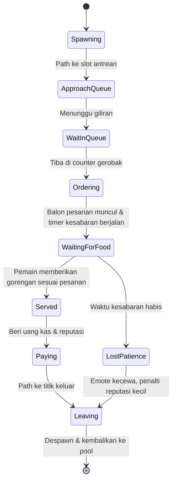
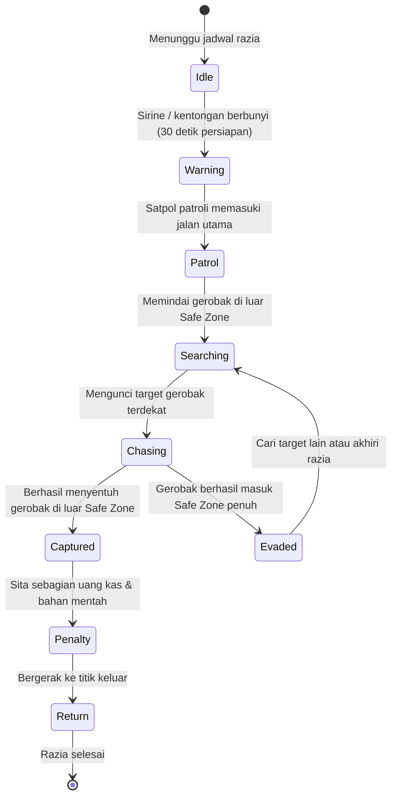

# TECHNICAL ARCHITECTURE — GORENGAN 24 JAM: AWAS SATPOL!

**Versi:** 1.0.0  
**Tanggal:** 2026-11-24  
**Target Engine:** Roblox (Luau Strict Typing)  
**Kapasitas Server:** 8 Pemain  

---

## 1. Prinsip Desain Arsitektur

Arsitektur didesain berdasarkan modulitas independen, minim dependensi sirkular, dan pemisahan wewenang yang tegas (*Separation of Concerns*):
1. **Server Owns Truth:** Semua mutasi inventaris, uang, status pesanan, status masak, deteksi penangkapan Satpol, dan persistence data berada di bawah kendali penuh server.
2. **Client Owns Input & Presentation:** Client menangkap input pengguna (PC keyboard/mouse dan Mobile Touch), memproyeksikan efek visual, animasi, tata suara 3D, dan HUD.
3. **Shared Contracts & Config:** Semua tipe data terdefinisi (`Types/`), nilai konfigurasi permainan (`Config/`), dan konstanta remote (`Remotes.luau`) berada di direktori bersama.
4. **Deterministic Lifecycle:** Inisialisasi service dan controller menggunakan urutan terprediksi (`Init` -> `Start`), tanpa mengandalkan `task.wait()` sembarangan.

---

## 2. Struktur Modul & Tata Letak Direktori

```text
src/
├── client/
│   ├── Bootstrap.client.luau          -- Entry point client
│   ├── Controllers/
│   │   ├── CookingController.luau     -- UI meter penggorengan & efek audio visual
│   │   ├── CartController.luau        -- Prediksi pergerakan gerobak & prompt interaksi
│   │   ├── CustomerUIController.luau  -- Tampilan balon pesanan & meter kesabaran NPC
│   │   ├── HUDController.luau         -- Pengelolaan HUD utama, uang kas, ATM, jam
│   │   ├── RaidFeedbackController.luau-- Efek visual sirine Satpol, kentongan, safe zone beacon
│   │   └── InputController.luau       -- Penanganan input terpadu PC (KBM) dan Touch Mobile
│   └── UI/
│       ├── Components/                -- Komponen UI reusable (Button, Meter, Dialog)
│       └── Screens/                   -- Layar antarmuka (CookingHUD, ShopModal, ATMModal)
│
├── server/
│   ├── Bootstrap.server.luau          -- Entry point server
│   └── Services/
│       ├── PlotService.luau           -- Pengelolaan plot pemain & spawning gerobak
│       ├── CookingService.luau        -- Pengawasan wajan, timing penggorengan, penentuan kualitas
│       ├── CustomerService.luau       -- Spawning antrean NPC, pesanan, kesabaran, pembayaran
│       ├── SatpolService.luau         -- Penjadwalan razia, AI patroli Satpol, mekanisme tangkap
│       ├── CartService.luau           -- Status dorong gerobak, validasi posisi, safe zone logic
│       ├── EconomyService.luau        -- Transaksi kas, setoran ATM, pembelian upgrade
│       ├── InventoryService.luau      -- Manajemen stok bahan mentah & gorengan matang/gosong
│       ├── TimeService.luau           -- Siklus 12 menit 24 jam in-game & cuaca
│       └── DataService.luau           -- Persistence DataStore, session locking, auto-save
│
└── shared/
    ├── Bootstrap/
    │   └── ServiceRunner.luau         -- Loader terpadu untuk siklus Init() dan Start()
    ├── Config/
    │   ├── RecipesConfig.luau         -- Parameter bahan, durasi masak, margin profit
    │   ├── UpgradesConfig.luau        -- Tingkat upgrade gerobak, wajan, kompor
    │   ├── EconomyConfig.luau         -- Saldo awal, denda Satpol, tarif ATM
    │   ├── ChiliGachaConfig.luau      -- Probabilitas kelangkaan cabai & multiplier bonus
    │   └── TimeScheduleConfig.luau    -- Jadwal jam sibuk (rush hour) & jam razia
    ├── Network/
    │   ├── Remotes.luau               -- Registry definisi RemoteEvent & RemoteFunction
    │   └── NetBridge.luau             -- Wrapper jaringan aman dengan verifikasi payload
    ├── Types/
    │   ├── GameplayTypes.luau         -- Tipe data resep, status masak, pesanan, gerobak
    │   └── PlayerDataTypes.luau       -- Skema data pemain untuk persistence
    └── Utility/
        ├── MathUtil.luau              -- Helper interpolasi, clamp, kalkulasi probabilitas
        └── Signal.luau                -- Modul event emitter cepat untuk pub-sub lokal
```

---

## 3. Siklus Hidup Layanan (Service Lifecycle)

Setiap Service di Server dan Controller di Client mengimplementasikan antarmuka standar:
```lua
export type Service = {
    Name: string,
    Init: (self: Service) -> (),
    Start: (self: Service) -> (),
}
```
1. **Fase Registrasi:** Modul di-require secara berurutan.
2. **Fase `Init()`:** Setiap service menyiapkan data internal, membuat remote folder jika belum ada, dan menyiapkan listener lokal. Pada fase ini dilarang memanggil method service lain yang belum diinisialisasi.
3. **Fase `Start()`:** Dijalankan setelah seluruh service menyelesaikan `Init()`. Service dapat saling berinteraksi, memulai task loop berulang (`task.spawn`), dan membuka koneksi jaringan.

---

## 4. Pola Komunikasi Jaringan & Remote Registry

Komunikasi client-server menggunakan sistem intent-based, di mana client meminta eksekusi aksi, bukan mengirim data hasil:

```
[CLIENT]                                            [SERVER]
   |                                                   |
   |---- RequestStartCooking(recipeId) --------------->| CookingService: Validasi stok bahan & wajan kosong
   |<--- CookingStarted(recipeId, startTime) ---------| Mulai timer server, kirim sinyal ke client
   |                                                   |
   | (Client menampilkan timing gauge interaktif)      |
   |                                                   |
   |---- RequestCollectFood() ------------------------>| CookingService: Hitung elapsed = now - startTime
   |<--- FoodCollected(resultQuality, itemData) -------| Tentukan (Undercooked/Crispy/Burnt), beri item
   |                                                   |
   |---- RequestServeCustomer(customerId) ------------>| CustomerService: Validasi kecocokan item & jarak
   |<--- CustomerServed(success, payout, tip) ---------| EconomyService: Tambah CarriedCash, despawn customer
```

### Validasi Keamanan pada Remote Receiver:
1. **Type & Payload Assertion:** Memastikan tipe parameter sesuai dengan ekspektasi (`string`, `number` valid).
2. **Magnitude Check:** Memastikan jarak antara karakter pemain dan objek target (wajan, gerobak, customer, ATM) tidak melebihi jarak batas wajar (misal: 15 studs).
3. **Ownership Validation:** Memverifikasi bahwa pemain hanya mengoperasikan wajan atau gerobak di plot miliknya.
4. **Rate Limiting:** Menggunakan interval cooldown per-pemain untuk menolak permintaan spam.

---

## 5. Model Fisika & Integritas Pergerakan Gerobak

Tantangan utama pada mekanik dorong gerobak adalah menghindari exploit fisika sekaligus menjaga pergerakan tetap responsif:
- Gerobak terdiri dari model dengan `PrimaryPart` yang menjadi pusat koordinat.
- Ketika pemain mengaktifkan prompt "Dorong Gerobak", server menetapkan status `IsPushing = true` pada pemain dan mengikat gerobak ke karakter via `AlignPosition` / `AlignOrientation` atau pengelasan dinamis (`WeldConstraint`), sembari menurunkan walkspeed pemain sesuai bobot gerobak.
- **Validasi Server:** Server memeriksa `Position` gerobak secara berkala. Jika terjadi lompatan jarak seketika (teleportasi melebihi kecepatan lari maksimal), gerobak dikembalikan ke koordinat valid terakhir (*rubberband protection*).
- **Safe Zone Checking:** Area gang ruko/zona aman memiliki `ZonePart` transparan tanpa tabrakan. Server melakukan pengecekan `workspace:GetPartsInPart` terhadap bounding box gerobak untuk mengonfirmasi keselamatan gerobak saat razia berlangsung.

---

## 6. AI State Machine untuk NPC

### 6.1 Customer State Machine


### 6.2 Satpol PP State Machine


---

## 7. Skema Data Persistence

Data pemain disimpan menggunakan struktur dokumen modular terkompresi dengan skema versi:

```lua
export type PlayerProfile = {
    SchemaVersion: number,
    LastSaveTime: number,
    CarriedCash: number,          -- Uang tunai yang dibawa
    BankedCash: number,           -- Saldo tabungan di ATM (Aman)
    Reputation: number,           -- Reputasi pedagang
    UnlockedRecipes: { string },  -- Daftar id resep yang terbuka
    Upgrades: {
        CartTier: number,         -- Kecepatan & kapasitas gerobak
        PanCapacity: number,      -- Jumlah gorengan sekaligus
        StoveSpeed: number,       -- Efisiensi waktu masak
        OilQuality: number,       -- Memperlebar window "Crispy"
    },
    ChiliInventory: { [string]: number }, -- Koleksi cabai langka
    Stats: {
        TotalCooked: number,
        TotalBurnt: number,
        TotalCustomersServed: number,
        TotalRaidsSurvived: number,
    }
}
```
Strategi penyimpanan menggunakan `UpdateAsync` dengan validasi session locking saat pemain bergabung dan keluar.
